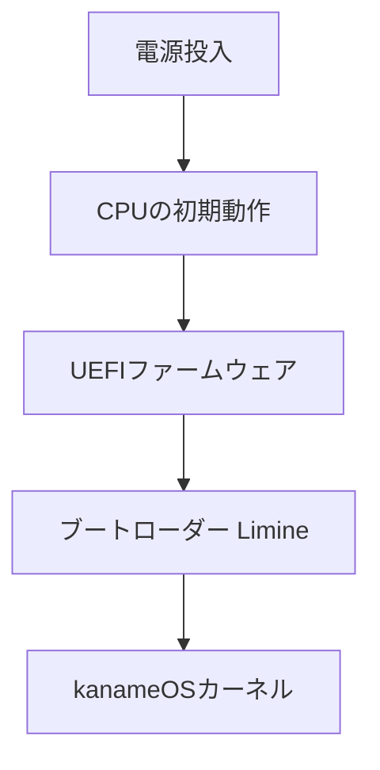

# 第3章 PCが起動するまで

## 起動の流れ

UEFIはファームウェアの仕組み。ブートローダーはカーネルを読み込み、必要な実行環境を整えて制御を渡す。QEMUはPCをエミュレート・仮想化するソフトウェア、OVMFはQEMU等で使えるUEFIファームウェア。

## 用語
- **ESP**: EFI System Partition。UEFI起動用ファイルを配置するパーティション。
- **ELF**: Executable and Linkable Format。実行コードと配置情報等を含む形式。
- **Limine**: OS開発で利用できるブートローダー。
